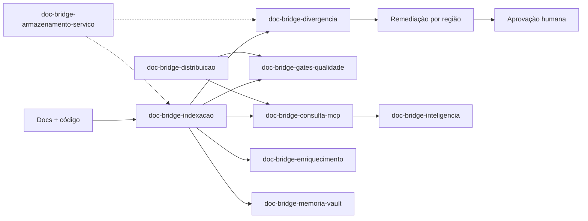

# 00 Hub - doc-bridge

> [!tldr] Em linguagem comum
> É o mapa que ajuda uma pessoa ou um agente de IA a descobrir onde mexer num projeto, o que ler antes e como conferir a mudança. Também compara duas versões do projeto para avisar quando a documentação ficou desatualizada e prepara correções que alguém precisa aprovar. O núcleo funciona sem IA e sem chave de API.

← [[Camada - Ferramentas]]

## Para que existe e quem usa

Repositório **público** (MIT) que publica **um único pacote npm**, `@agentskit/doc-bridge` 2.1.0, com dois binários: `ak-docs` (o motor) e `ak-verify` (um repasse para o CLI de [[00 Hub - harness]]) (`package.json:2`, `package.json:7-10`, `bin/ak-verify.js:5-7`). O workspace pnpm declara só a raiz; as "peças" abaixo são áreas de `src/`, não pacotes separados (`pnpm-workspace.yaml:1`). O build gera quatro entradas: biblioteca, `config`, CLI e o programa opcional de remediação L2 (`tsup.config.ts:4-9`), expostas por `exports` (`package.json:13-26`).

A regra de ouro do repo é a **Layer 0 determinística**: `init`, `index`, `query`, `list`, gates e as ferramentas MCP de handoff não podem exigir LLM nem chave (`AGENTS.md:16-17`, `CONTRIBUTING.md:44`). IA entra só em camadas opcionais (RAG/chat, agentes do Registry, remediação L2).

| Público | Uso |
|---|---|
| Agente de código (Claude, Cursor, Codex…) | MCP `handoff.resolve` / `doc.search` / `doc.get` ou `ak-docs query … --agent` para saber `startHere`, `editRoots` e `checks` |
| Mantenedor de repo | `ak-docs index`, gates, `doctor`, Action de CI, advisory de PR |
| Consumidor de biblioteca | [[engine-runner]] em [[00 Hub - alexandria]] usa a API pública para comparar checkouts |
| Leitor humano | Portal [[doc-bridge-docs]] |

## Partes e fluxos

Repo sem grupos: o hub liga direto as notas de pacote/app.

| Nota | Papel | Área de código (edit root do índice) |
|---|---|---|
| [[doc-bridge-indexacao]] | Descobrir entidades/relações e materializar `.doc-bridge/index.json`, `llms.txt` e capabilities | `src/index-builder`, `src/discovery`, `src/retrieval`, `src/graph`, `src/entities` |
| [[doc-bridge-consulta-mcp]] | Responder consultas e handoffs pela CLI e pelo servidor MCP stdio | `src/query`, `src/mcp`, `src/cli` |
| [[doc-bridge-divergencia]] | Comparar snapshots (ChangeSet), gerar findings e remediações por região | `src/diff`, `src/findings`, `src/fixes` |
| [[doc-bridge-gates-qualidade]] | Gates, conformidade `documentation-standard-v1`, auditoria, doctor, paridade pública, regras | `src/gates`, `src/conformance`, `src/audit`, `src/doctor`, `src/parity`, `src/rules` |
| [[doc-bridge-enriquecimento]] | Agentes do Registry, overlay de enriquecimento e aprovações | `src/agents`, `src/enrich` |
| [[doc-bridge-memoria-vault]] | Memórias de agente → rascunhos; export/diff do vault Obsidian | `src/memory`, `src/vault` |
| [[doc-bridge-inteligencia]] | RAG/chat opcionais e federação de `llms.txt` | `src/intelligence`, `src/federation`, `src/retriever` |
| [[doc-bridge-armazenamento-servico]] | IO plugável por partição e perfil `service` | `src/storage`, `src/execution`, `src/plugins`, `src/cli/service.ts` |
| [[doc-bridge-estudo]] | Protocolo, executor, métricas e benchmarks do estudo de eficiência | `src/study`, `src/bench`, `src/metrics`, `scripts/study-*.mjs` |
| [[doc-bridge-distribuicao]] | Action composta, MCPB, plugins Claude/Cursor/Copilot, skill portátil | `action.yml`, `scripts/action-runner.mjs`, `mcpb/`, `skills/` |
| [[doc-bridge-docs]] (app) | Portal Next/Fumadocs exportado estático | `apps/docs` |

| Fluxo | O que cobre |
|---|---|
| [[Doc Bridge - Do repositório ao handoff]] | config → descoberta → índice → handoff |
| [[Doc Bridge - Da divergência à correção revisável]] | snapshots base/head → ChangeSet → finding → remediação → aprovação |
| [[Doc Bridge - Da memória e do vault à proposta]] | memórias e notas editadas → rascunho/proposta pendente |
| [[Doc Bridge - Do PR ao advisory]] | Action em PR: índice CI-built, snapshots, comentário advisory |

| Guias | Decisões |
|---|---|
| [[Doc Bridge - Validar uma mudança antes do PR]] · [[Doc Bridge - Gerar e conferir o índice do repositório]] · [[Doc Bridge - Lançar uma versão]] · [[Doc Bridge - Construir e publicar o portal]] · [[Doc Bridge - Atualizar o snapshot do ecossistema]] | [[00 Decisões - doc-bridge]] (25 ADRs) · [[Auditoria - doc-bridge]] |

## Como se liga ao ecossistema

| Vizinho | Relação observada | Evidência |
|---|---|---|
| [[00 Hub - harness]] | Dependência direta fixa `@agentskit/harness` 0.22.3; `ak-verify` só repassa para o CLI dele | `package.json:136`, `bin/ak-verify.js:5-7` |
| [[00 Hub - agentskit]] | Peers opcionais `@agentskit/{core,rag,adapters,memory,ink}` + React para RAG/chat; deps diretas `@agentskit/cross-platform` e `@agentskit/net` | `package.json:135-137`, `package.json:161-188` |
| [[00 Hub - agentskit-chat]] | Portal usa `@agentskit/chat` 0.4.x (devDependency) | `package.json:190`, `apps/docs/components/chat-widget.tsx:4-5` |
| [[00 Hub - agentskit-registry]] | Agente padrão `ecosystem-doc-bridge-corpus-scanner` instalado em `agents/` | `src/agents/registry-adapter.ts:15`, `src/agents/registry-adapter.ts:208` |
| [[00 Hub - alexandria]] | [[engine-runner]] consome a API pública (fixada em 2.0.0 segundo o hub de Alexandria) | ver [[00 Hub - alexandria]] |
| [[00 Hub - agents-playbook]] | Rota de memória `playbook` e padrão `doc-bridge-pattern` exportado | `src/memory/pipeline.ts:41-43`, `src/index.ts:659-664` |
| [[00 Hub - ecosystem-distribution-ops]] | Publica o MCP do Doc Bridge em registries externos (fora deste repo) | ver [[00 Hub - ecosystem-distribution-ops]] |

## Dados, deploy e CI

- **Sem banco nem serviço hospedado obrigatório.** O motor roda na máquina ou CI do consumidor e grava artefatos sob `.doc-bridge/` (índice, capabilities, workflow, proposta, enriquecimento, aprovações, rascunhos) mais `llms.txt` na raiz. Detalhes em cada nota.
- **Perfil `service`** ([[doc-bridge ADR-0012 - Perfil de serviço imposto pelo chamador]]): o chamador confiável impõe um teto de capacidades (sem módulos do repo, sem rede, sem escrita local fora do artefato designado). Isso não prova que exista um serviço hospedado aqui; veja [[doc-bridge-armazenamento-servico]].
- **Portal**: `apps/docs/out` (export estático Next). `pages.yml` publica no GitHub Pages com domínio `doc-bridge.agentskit.io` (`.github/workflows/pages.yml:34-54`); `wrangler.toml` descreve Cloudflare Workers static assets via `pnpm cf:deploy` manual (`wrangler.toml:1-11`, `package.json:105`); `vercel.json` ainda existe (`vercel.json:15-18`). Qual host serve o tráfego hoje não é provado pelo código.
- **npm**: dois caminhos de publicação — `release.yml` em tag `v*.*.*` publica o tarball verificado com provenance (`.github/workflows/release.yml:3-6`, `.github/workflows/release.yml:99-113`) e `changesets.yml` em push na `main` roda `pnpm release` = `changeset publish` (`.github/workflows/changesets.yml:61-71`, `package.json:81`). Changesets é o caminho rotineiro; `release.yml` é a recuperação guardada para tag imutável (`docs/RELEASE.md:41-49`, `CONTRIBUTING.md:77-86`). Ver [[Doc Bridge - Lançar uma versão]].
- **CI** (`ubuntu-latest`): `ci.yml` faz imports legados, cross-platform, typecheck, upstream do ecossistema, marketplace, testes, cobertura, build, README standard, `npm pack --dry-run`, smoke empacotado, índice determinístico (build duplo + `cmp`), gate/conformidade/doctor, paridade pública, benchmark de retrieval, a própria Action com `engine: checkout`, e o job `docs` com Lighthouse e Playwright (`.github/workflows/ci.yml:16-122`). `doc-bridge-advisory.yml` roda a Action publicada (fixada no commit da 2.0.0) em cada PR com comentário (`.github/workflows/doc-bridge-advisory.yml:20-25`). `ecosystem-sync.yml` abre PR diário com o snapshot do ecossistema. CodeQL, Scorecard e dependency-review cobrem segurança.

> [!warning] Limite da evidência
> Métricas do README/estudo (redução de contexto, tokens, hit@3) descrevem casos medidos; não garantem correção semântica geral. Prosa natural continua `not-analyzed` sem revisão humana ou de agente (`docs/adr/0002-documentation-audit-boundary.md:13`).

> [!info]- Detalhe técnico
> - Pacote e binários: `package.json:2-10`; entradas tsup `tsup.config.ts:4-9`.
> - Barrel público com ~1100 linhas de exports: `src/index.ts:1-1133`.
> - Despacho da CLI por perfil/Action/advisory: `src/cli/program.ts:1565-1577`.
> - Ownership deste próprio repo (fonte do índice): `doc-bridge.config.json:30-104`.
> - Action composta: `action.yml:74-188`; MCPB só declara `darwin`: `mcpb/manifest.json:124-130`.

O que não foi confirmado pertence a [[Dúvidas abertas]]; capacidades condicionais ou sem chamador encontrado vão para [[Capacidades não usadas]].
