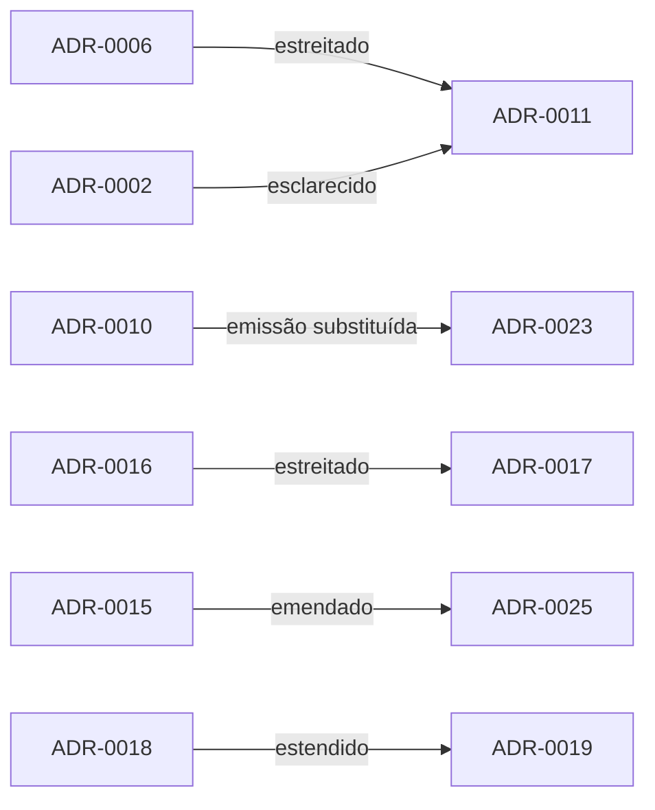

# 00 Decisões - doc-bridge

> [!tldr] Em linguagem comum
> Índice das 25 decisões de arquitetura do Doc Bridge, agrupadas por tema. A linha comum: provar só o que dá para provar sem IA, deixar visível o que não foi analisado e nunca deixar uma máquina aprovar o próprio trabalho.

← [[00 Hub - doc-bridge]]

Os ADRs ficam em `docs/adr/NNNN-*.md`. Três ainda dizem **proposed** no arquivo (0018, 0019, 0021), mas 0018 e 0019 já estão implementados (ver [[Auditoria - doc-bridge]]).

## Diff, findings e remediação

| ADR | Status | Data | Em uma linha |
|---|---|---|---|
| [[doc-bridge ADR-0010 - ChangeSet versionado e identidade semântica]] | aceito (parcialmente substituído por 0023) | 2026-10-06 | ChangeSet, remoção provada, hash semântico separado da proveniência, purl/vers |
| [[doc-bridge ADR-0011 - Findings e remediação por região]] | aceito | 2026-10-06 | Finding / Remediation / Decision separados; edição por região com hash; apresentação ≠ aceitação |
| [[doc-bridge ADR-0016 - Evidência de compatibilidade de chamáveis]] | aceito (estreitado por 0017) | 2026-10-08 | Prova limitada de assinatura compatível só no diff |
| [[doc-bridge ADR-0017 - Compatibilidade com imports locais]] | aceito | 2026-10-08 | Prova atravessa imports locais com limites; exceção de heritage |
| [[doc-bridge ADR-0022 - Aceitação de propostas L2]] | aceito | 2026-10-09 | Proposta de IA só aparece se a reanálise em memória limpar o finding |
| [[doc-bridge ADR-0023 - Afirmações sobre referências alteradas]] | aceito | 2026-10-09 | `CHANGED_REFERENCE` só quando o trecho afirma algo sobre o aspecto alterado |
| [[doc-bridge ADR-0024 - Scripts de entrada e citações de palavra solta]] | aceito | 2026-10-10 | Palavra solta não cita script de entrada sem âncora |

## Qualidade, gates e CI

| ADR | Status | Data | Em uma linha |
|---|---|---|---|
| [[doc-bridge ADR-0002 - Fronteira da auditoria de documentação]] | aceito (emendado por 0011) | 2026-08-29 | Auditoria determinística; semântica `not-analyzed`; docs geradas intocadas |
| [[doc-bridge ADR-0005 - Qualidade e criticidade da documentação]] | aceito | 2026-08-30 | Tier, criticidade e dimensões de qualidade independentes |
| [[doc-bridge ADR-0015 - Action de advisory e índice gerado na CI]] | aceito (emendado por 0025) | 2026-10-06 | `committed` vs `ci-built`; advisory separado dos gates; PR é dado não confiável |
| [[doc-bridge ADR-0025 - Gate opt-in de publicação]] | aceito | 2026-10-14 | `reference-findings` bloqueia `index` só se o mantenedor pedir |

## Arquitetura e segurança de execução

| ADR | Status | Data | Em uma linha |
|---|---|---|---|
| [[doc-bridge ADR-0012 - Perfil de serviço imposto pelo chamador]] | aceito | 2026-10-06 | Teto de capacidades do chamador; allowlist de folhas de config |
| [[doc-bridge ADR-0013 - Adaptadores de descoberta neutros de linguagem]] | aceito | 2026-10-06 | Linguagens por adaptador; JS/TS como primeiro plugin |
| [[doc-bridge ADR-0014 - IO plugável e partições por revisão]] | aceito | 2026-10-06 | IO injetado, partição repositório + revisão exata |

## Agentes, enriquecimento, conhecimento e memória

| ADR | Status | Data | Em uma linha |
|---|---|---|---|
| [[doc-bridge ADR-0006 - Ancoragem da revisão semântica do Registry]] | aceito (estreitado por 0011) | 2026-08-30 | Agente do Registry só com diagnóstico e evidência reais; saída consultiva |
| [[doc-bridge ADR-0018 - Entidades de conhecimento opt-in]] | proposto (implementado) | 2026-10-08 | Seção `knowledgeEntities` só com opt-in |
| [[doc-bridge ADR-0019 - Fonte de memória e evidência de entidade]] | proposto (implementado) | 2026-10-08 | Diretórios de memória configuráveis; `memory-supports` exato |
| [[doc-bridge ADR-0020 - Revisão de edições no vault gerado]] | aceito | 2026-10-08 | Edição no vault vira proposta `vault-edit` pendente |

## Estudo e verificação

| ADR | Status | Data | Em uma linha |
|---|---|---|---|
| [[doc-bridge ADR-0001 - Contrato de verificação enterprise]] | aceito | 2026-08-28 | Perfis e superfícies de verificação com estados auditáveis |
| [[doc-bridge ADR-0003 - Protocolo de estudo e evidência histórica]] | aceito | 2026-08-30 | Protocolo versionado; histórico é observacional |
| [[doc-bridge ADR-0004 - Executor controlado do estudo]] | aceito | 2026-08-30 | Processo filho isolado, só metadados e hashes |
| [[doc-bridge ADR-0007 - Métricas longitudinais do estudo]] | aceito | 2026-08-30 | Eficiência subordinada à qualidade; incerteza explícita |
| [[doc-bridge ADR-0008 - Fronteira de verificação do estudo]] | aceito | 2026-08-31 | Só resultado selado é publicável |
| [[doc-bridge ADR-0009 - Adaptador CLI de provedores do estudo]] | aceito | 2026-08-31 | Provedores por CLI sem shell, env em allowlist |
| [[doc-bridge ADR-0021 - Execução isolada do estudo mínimo]] | proposto | 2026-10-09 | Estudo mínimo via Claude Code headless com teto de gasto |

## Cadeias de substituição

O que não foi confirmado pertence a [[Dúvidas abertas]]; capacidades condicionais ou sem chamador encontrado vão para [[Capacidades não usadas]].
